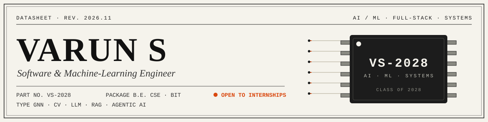
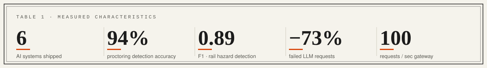
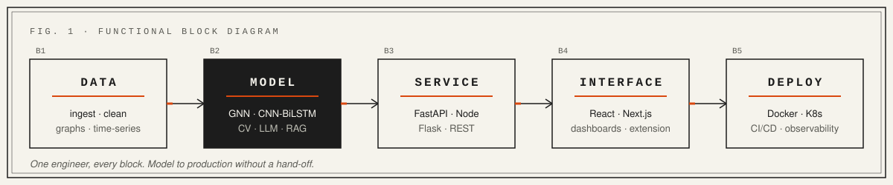
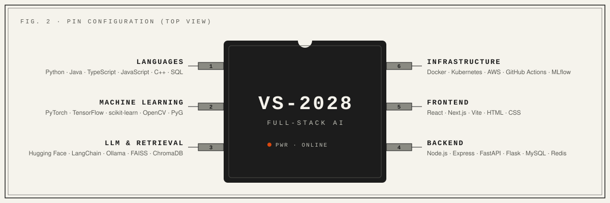
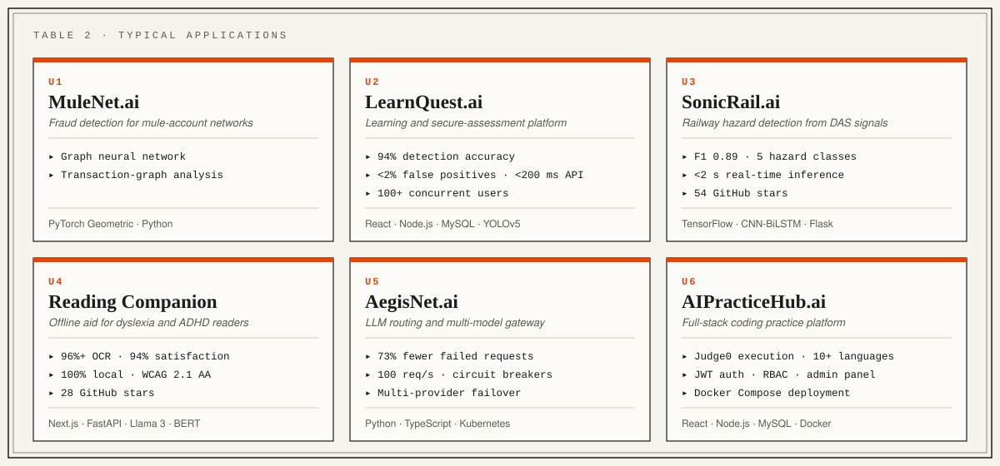
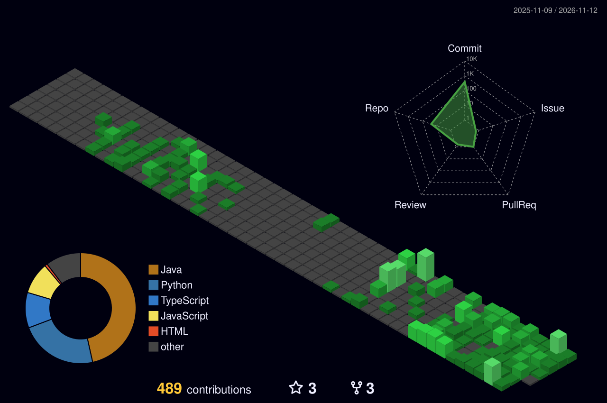

 

**[LinkedIn](https://www.linkedin.com/in/varun-s-41bb95357/)** &nbsp;·&nbsp; **[GitHub](https://github.com/Varun072006?tab=repositories)** &nbsp;·&nbsp; **[LeetCode](https://leetcode.com/u/wYbMiQ6gOX)**

 

 

## General Description

**Mr. VARUN S** is a AI and machine-learning engineer built to turn research-grade ideas into systems people actually use. It covers the whole path from model to product: graph neural networks, computer vision and LLM pipelines on one side, APIs, databases and deployment on the other.

Computer Science student at **Bannari Amman Institute of Technology** (class of 2028). Six AI systems shipped. Available for **AI/ML and software engineering internships**.

 

## Features

- **End-to-end delivery.** Model, API, UI and container, all owned by one engineer.
- **Applied AI breadth.** GNNs, computer vision, LLMs, RAG and agentic workflows.
- **Privacy-first design.** Offline, on-device inference where the use case allows it.
- **Production habits.** Auth and RBAC, indexed queries, CI/CD, observability, containerised deploys.
- **Measured, not claimed.** Every project below carries the numbers it was judged on.

 

## Pin Configuration

 

## Typical Applications

<b>Detail on each device</b>

 

**MuleNet.ai.** A graph-neural-network engine that flags mule-account behaviour in transaction networks.

**LearnQuest.ai.** JWT authentication with role-based access. Code runs in a sandbox via Judge0 and the Monaco editor across 10+ languages. AI proctoring covers face detection, gaze tracking and phone detection. Indexed queries and a CI/CD pipeline.

**SonicRail.ai.** Trained on 10,000+ synthetic distributed-acoustic-sensing samples. A Flask API feeds a React dashboard with live monitoring and alert streaming.

**Adaptive Cognitive Reading Companion.** 100% local inference, so no data leaves the device. OCR through PaddleOCR, simplification through Llama 3 and BERT. Published as a Chrome extension.

**AegisNet.ai.** Weighted routing across multiple AI providers, circuit breakers and automated failover. Observability through OpenTelemetry and Prometheus.

**AIPracticeHub.ai.** JWT and RBAC, automated code evaluation through Judge0, an optimised MySQL schema, an admin dashboard and Docker Compose deployment.

Source for everything lives at **[github.com/Varun072006](https://github.com/Varun072006?tab=repositories)**.

 

## Recognition & Qualification

| Competitions entered                      | Certifications                              |
| :---------------------------------------- | :------------------------------------------ |
| Intellitrace 2026 (fintech & banking AI)  | Cisco · Python Essentials 1                 |
| ANZ Diversity Hackathon                   | HP LIFE · Python for Data Science           |
| AI for Bharat (educational accessibility) | Simplilearn · Machine Learning Using Python |
| AMD Slingshot (AI + HPC)                  | Microsoft Azure Fundamentals                |
| Yuvaan by AVEVA (industrial AI)           | AWS Cloud Practitioner Essentials           |

 

## Activity

Contribution history, regenerated daily by GitHub Actions.

 

## Ordering Information

|                     |                                                                        |
| :------------------ | :--------------------------------------------------------------------- |
| **Availability**    | AI/ML and software engineering internships                             |
| **Best channel**    | [LinkedIn](https://www.linkedin.com/in/varun-s-41bb95357/)             |
| **Open work**       | [GitHub repositories](https://github.com/Varun072006?tab=repositories) |
| **Problem solving** | [LeetCode](https://leetcode.com/u/wYbMiQ6gOX)                          |

 

VS-2028 · Datasheet Rev. 2026.11 · Specifications subject to improvement without notice.

